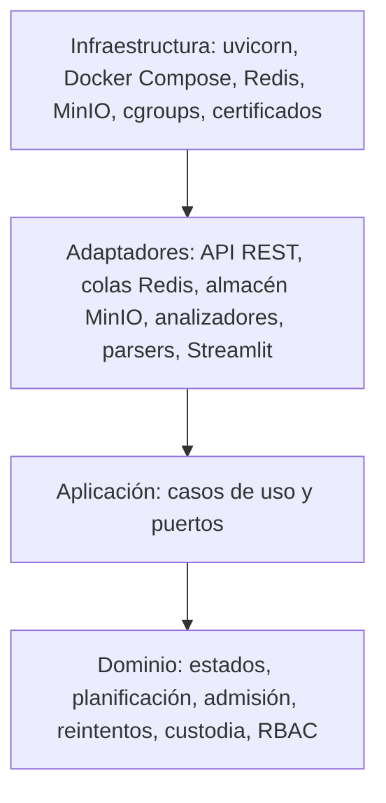
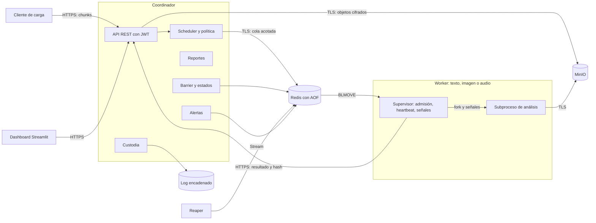
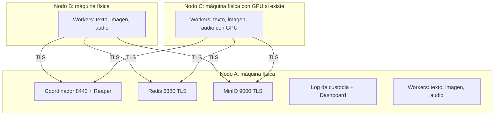
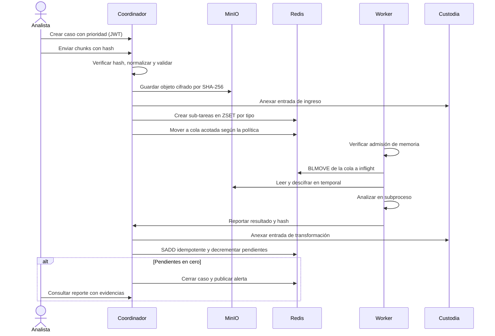
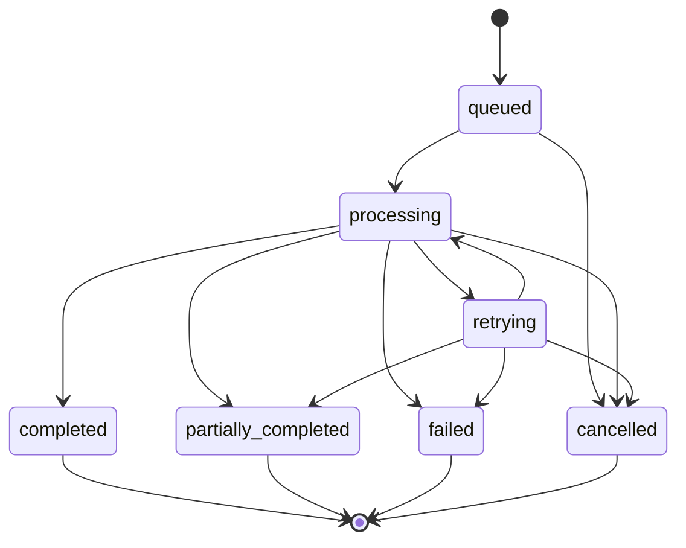

**Resumen:** Arquitectura ADD que extiende el I Proyecto (FastAPI, Redis, MinIO, workers *pull*) con límites de memoria, planificación con aging, E/S por chunks, seguridad y routing medido, en tres nodos worker.

# Arquitectura

Requisitos en `REQUERIMIENTOS.md`. **Ningún dato de rendimiento de este sistema se ha medido todavía.** Donde una decisión depende de una medición, se indica «Medición pendiente» y la ficha que la producirá. Toda decisión de ese tipo es provisional hasta tener el dato.

## 1. Línea base: I Proyecto

Repositorio `nahum0804/distributed-processing-platform`, commit `bc6bab6` de `main`. Las limitaciones provienen de su `docs/DECISIONES_DISENO.md`.

| Elemento | Estado en el I Proyecto | Acción | Requisito |
|---|---|---|---|
| Coordinador FastAPI sin estado propio | Funciona; estado en Redis | Reutilizar y extender | RF-01, RF-44 |
| Barrier/join idempotente (`SADD`) | Funciona | Reutilizar | RF-10 |
| Heartbeat y reaper | Reencola en ~25 s (declarado, sin logs en `docs/evidencia/`) | Reutilizar y volver a medir | RF-43 |
| Consumo `BLPOP` + `WATCH/MULTI` | Ventana de pérdida de milisegundos | Modificar | RF-44, RNF-03 |
| Prioridad estricta `:high` | Admite inanición | Reemplazar | RF-29 |
| Cancelación | No detiene FFmpeg en curso | Reemplazar | RF-12 |
| Workers | Solo FFmpeg, sin modelos ni texto | Nuevo | RF-06 a RF-08 |
| Límites de memoria | No existen | Nuevo | RF-24 |
| TLS, autenticación | No existen; MinIO con credencial por defecto | Nuevo | RF-35, RF-36 |
| Dashboard Streamlit | Funciona | Reutilizar y extender | RF-17 |
| Evidencia en 3 máquinas | Pendiente; se probó en una sola | Obligatorio | RNF-01 |

## 2. Escenarios de atributos de calidad

| ID | Atributo | Estímulo | Entorno | Respuesta | Medida | Req. |
|---|---|---|---|---|---|---|
| QA-01 | Memoria por worker | Ráfaga que supera la capacidad de un worker | Nodo real con `memory.max` | Se admite lo que cabe; el resto espera en cola | `memory.current` por worker a lo largo del tiempo; sub-tareas admitidas contra rechazadas | M1 |
| QA-02 | Recuperación de OOM | Sub-tarea que excede el límite | Worker con límite reducido | Se detecta, se clasifica como `oom` y se reencola según la política | `oom_kill` en `memory.events`; estado final; tiempo de recuperación | M1 |
| QA-03 | Equidad sin inanición | Flujo sostenido de casos altos con casos bajos en espera | Scheduler con FIFO y con aging | Los casos bajos avanzan aunque siga llegando carga alta | Espera, turnaround y throughput por nivel; espera máxima de prioridad baja acotada | M2 |
| QA-04 | Throughput de E/S | Transferencia ≥ 200 MB | Red real entre nodos | Reensamblado correcto y verificado | MB/s para ≥ 3 tamaños de chunk; coincidencia de SHA-256 | M3 |
| QA-05 | Backpressure | Productores más rápidos que los consumidores | Ráfaga, con y sin límite | Se rechaza o bloquea al productor; la cola no crece sin límite | Profundidad de cola y tiempos de respuesta en el tiempo | M3 |
| QA-06 | Confidencialidad | Captura de tráfico o lectura directa del almacenamiento | Operación normal | Tráfico y objetos ilegibles sin llave | `tshark` muestra TLS; el objeto no contiene el texto original | M4 |
| QA-07 | Integridad de custodia | Alteración de una evidencia o de una entrada del log | Sistema detenido o activo | El verificador falla e indica la posición | Detección en cada manipulación probada | M4 |
| QA-08 | Control de acceso | Acción no permitida por el rol | API activa | Se deniega y se registra | 401 y 403 esperados por rol y acción | M4 |
| QA-09 | Routing por tipo de nodo | Sub-tarea de inferencia con nodos heterogéneos | Benchmarks completos | Se despacha según la tabla medida; hay alternativa si no hay nodo preferido | Latencia, throughput y memoria por configuración; decisión trazable | M5 |
| QA-10 | Rendimiento bajo ráfaga | ≥ 20 casos concurrentes | Tres nodos | Todos los casos alcanzan estado final | Throughput, latencia por caso, recursos por nodo | B.6 |
| QA-11 | Tolerancia a caída de worker | `docker kill` durante un caso | Tres nodos | Detección, reasignación y estado final correcto | Tiempo de detección y de reasignación; conteo de sub-tareas | B.6 |
| QA-12 | Recuperación del coordinador | Reinicio con casos en curso | Tres nodos | Continúa desde el estado persistido | Sub-tareas sin perder ni duplicar; tiempo de retoma | B.6 |
| QA-13 | Liberación de recursos | Cancelar un caso pesado en curso | Worker con sub-tarea activa | Mata procesos y libera memoria y temporales | Procesos, memoria y temporales antes y después; tiempo de liberación | B.6 |
| QA-14 | Estabilidad bajo saturación | Carga mayor que la memoria del nodo | Nodo con control de admisión | El nodo sigue operando | Heartbeats continuos; sin OOM del host | B.6, M1 |

## 3. Tácticas por atributo

| Atributo | Tácticas | Decisión |
|---|---|---|
| Memoria | cgroups v2 por contenedor; sin swap; control de admisión con huella medida; reencolado por OOM | AD-05, AD-06, AD-07 |
| Equidad | Prioridad con aging implícito; scheduler como política intercambiable | AD-04 |
| Rendimiento de E/S | Chunks de tamaño medido; almacenamiento por contenido; recepción no bloqueante | AD-10, AD-11, AD-13 |
| Disponibilidad | Colas acotadas; rechazo con `Retry-After`; heartbeat y reaper; idempotencia | AD-03, AD-12 |
| Recuperación | Coordinador sin estado; estado en Redis con AOF, que actúa como checkpoint; reconciliación al arrancar | AD-21 |
| Liberación de recursos | Sub-tarea en subproceso propio; señal a su grupo de procesos; temporales propiedad del supervisor | AD-08, AD-09 |
| Seguridad | TLS con CA privada; cifrado de sobre; log encadenado; JWT con roles; contenedores sin privilegios | AD-14 a AD-17 |
| Heterogeneidad | Routing por tabla derivada de benchmarks; alternativa si falta el nodo preferido | AD-18 |

## 4. Capas (Clean Architecture)

Las dependencias apuntan hacia el dominio. El dominio no importa `redis`, `fastapi`, `minio` ni modelos. Una prueba analiza los `import` para hacer cumplir esta regla.

| Capa | Ruta | Contenido |
|---|---|---|
| Dominio | `src/domain/` | `case_state`, `scheduling`, `admission`, `retry`, `oom_policy`, `routing`, `custody_chain`, `rbac`, `severity`, `chat_message` |
| Aplicación | `src/application/` | `create_case`, `dispatch_next`, `report_result`, `cancel_case`, `build_report`, `verify_custody`, `ports` |
| Adaptadores | `src/adapters/` | `api/`, `redis_queue`, `redis_case_repository`, `minio_object_store`, `whatsapp_parser`, `telegram_parser`, `text_analyzer`, `image_analyzer`, `audio_analyzer`, `ffmpeg_media` |
| Infraestructura | `src/infrastructure/`, `deploy/` | Composición, configuración, lectura de cgroups, TLS, Compose por nodo |

**Contratos compartidos.** `src/domain/priority.py`, `src/domain/finding.py` y `src/application/ports.py` son el acuerdo entre módulos: permiten avanzar con fakes sin esperar a los demás. Son la primera versión. Quien necesite cambiarlos lo hace en una PR y avisa a los módulos afectados.

**Coordinador.** `src/coordinator/` se divide en `rutas_casos`, `rutas_subtareas`, `rutas_monitoreo`, `modelos`, `conexion` y `apoyo`; `main.py` solo compone la aplicación.

**Migración gradual.** El código del I Proyecto no se reescribe en bloque, porque hay poco tiempo y sus pruebas son la red de seguridad. La lógica nueva nace en `domain` y `application`; el código existente se mueve a `adapters` solo cuando se toca.

## 5. Diagrama de componentes

## 6. Diagrama de despliegue

Restricciones de despliegue:

- Cada contenedor worker tiene `mem_limit` igual a `memswap_limit`, de modo que el límite no se evade con swap.
- La suma de límites de un nodo no supera su RAM menos una reserva. Un script lo comprueba antes del arranque.
- **Cada tipo de worker debe existir en al menos dos nodos.** Sin eso, la caída de un worker no tiene a quién reasignar sus sub-tareas [B.6].
- El Nodo A concentra servicios. Es un punto único de falla aceptado: [B.6] solo exige reiniciar el coordinador, no alta disponibilidad.
- Un nodo Windows opera con Docker sobre WSL2, como en la rama `evidencia-gpu` del I Proyecto. Sus cgroups son los de la VM de WSL2. **Las mediciones de M1 deben hacerse en un nodo Linux** o declarar esa diferencia en la ficha.

## 7. Flujo de un caso

## 8. Registro de decisiones

«Fuente» distingue referencia consultable de medición. Referencias en §10.

| ID | Decisión | Alternativas | Criterio de elección | Fuente |
|---|---|---|---|---|
| AD-01 | Extender el I Proyecto | Reescribir | [B.2] motiva reutilizar y evalúa lo nuevo; tiempo disponible | Medición del repo: 18 archivos, 387 funciones de prueba, 474 casos pasan y 3 se omiten |
| AD-02 | Tres nodos físicos, servicios en el Nodo A | Cuarta máquina; VMs en un solo equipo | [B.2] rechaza una sola máquina | [B.2]; SUP-04 |
| AD-03 | Redis con `BLMOVE` a lista `inflight:{worker}` | Redis Streams; RabbitMQ | Cierra la ventana de pérdida con el menor cambio; conserva `recovery.py` y reaper | R1; limitación declarada del I Proyecto. Entrega al menos una vez, compensada por AD-21 |
| AD-04 | ZSET por tipo con `puntaje = t_entrada − bono(prioridad)`, el menor sale primero | Prioridad estricta; WFQ; MLFQ | Aging implícito sin temporizadores: un caso de prioridad baja solo puede ser adelantado por casos que entren hasta `bono(crítica) − bono(baja)` después de él; con llegadas finitas, su espera queda acotada. Selección O(log n) | R2 cap. 5; R3. **Medición pendiente:** ficha M2, comparada con FIFO |
| AD-05 | Un contenedor por tipo de worker con `mem_limit`, sin swap | `systemd MemoryMax=`; un solo contenedor para todos | Reutiliza Compose; aísla un OOM a un tipo; cgroups v2 lo aplica el kernel | R4, R5; [B.5 M1] |
| AD-06 | Admisión en el worker antes de sacar de la cola: `memory.current + huella(modelo) ≤ memory.max × (1 − margen)` | Concurrencia fija; reservas en el coordinador | Encaja con el modelo *pull*: lo que no se saca sigue en cola y otro nodo puede tomarlo. No centraliza el estado de memoria | R4. **Medición pendiente:** huella de ficha M1 |
| AD-07 | Implementar ambas estrategias; elegir con datos. Provisional: modelo por proceso | `fork` tras cargar (CoW); `mmap` | Comparar con PSS, porque RSS cuenta varias veces las páginas compartidas. Riesgos de CoW: el conteo de referencias de Python ensucia páginas (`gc.freeze` lo mitiga) y `fork` con hilos ya iniciados puede bloquearse. Lo compartido entre cgroups se carga a quien lo instanció, así que la comparación se hace dentro de un mismo cgroup | R2 cap. 10; R4; R6. **Medición pendiente:** ficha M1 |
| AD-08 | Cada sub-tarea corre en un subproceso con grupo propio; el supervisor es dueño de sus temporales | Hilos (actual); sin aislamiento | Un hilo de Python no se puede matar desde fuera. Si un hijo recibe `SIGKILL` no puede limpiar: debe hacerlo el padre. Un OOM del hijo no mata al supervisor | R2 cap. 3; limitación declarada del I Proyecto |
| AD-09 | Cancelación con clave `cancel:{caso}` y `PUBLISH`; `SIGTERM`, gracia, `SIGKILL`, `waitpid` | Solo Pub/Sub; solo sondeo | Pub/Sub aporta inmediatez pero no persiste; la clave cubre al suscriptor que estaba reconectando | R1 |
| AD-10 | Protocolo propio por chunks; tamaño fijado con datos, provisional 4 MiB | Subida directa a MinIO; protocolo tus | Permite medir y variar el chunk [B.5 M3]; simple de explicar | **Medición pendiente:** ficha M3, 256 KiB, 1 MiB, 4 MiB y 16 MiB |
| AD-11 | Dedup a nivel de archivo, clave SHA-256 del texto en claro | Chunks de tamaño fijo o variable | Mantiene separados los experimentos (SUP-13). El hash del contenido en claro es necesario, porque el cifrado aleatorio impide deduplicar sobre el texto cifrado. Revela si dos objetos son iguales: riesgo aceptado y declarado, porque el acceso al almacén es restringido | R9 (nonce aleatorio en GCM). **Medición pendiente:** tasa en ficha M3 |
| AD-12 | Dos niveles: API responde 503 con `Retry-After`; scheduler mueve solo si `LLEN < límite`, con script Lua atómico | Bloquear al productor; colas sin límite | Rechazar no retiene conexiones. El bloqueo en el scheduler conserva el orden de prioridad en el ZSET. Un parámetro desactiva el límite para el experimento | R1. **Medición pendiente:** ficha M3 |
| AD-13 | Recepción `async` en uvicorn; escritura en hilo acotado | Escritura síncrona; servicio separado | Reutiliza FastAPI; no bloquea el bucle de eventos | R7. **Medición pendiente:** RF-34 |
| AD-14 | JWT firmado con rol y `Depends` de FastAPI | Sesiones; Keycloak | Sin estado y sin un servicio más; B.7 lo sugiere | [B.7 Seguridad]; R2 cap. 16 y 17 |
| AD-15 | TLS 1.3 con CA privada y certificado por nodo, en API, Redis y MinIO | WireGuard; malla de servicios | La captura muestra TLS, como pide la evidencia; lo soportan los tres componentes de forma nativa | R8; [B.7 Seguridad] |
| AD-16 | AES-256-GCM en la aplicación, llave por objeto (DEK) envuelta por una KEK en archivo montado, permisos `0400`; nonce único por chunk | MinIO SSE; LUKS; Vault | Protege también contra quien lee MinIO. Vault agrega un servicio que operar con el tiempo disponible. Limitar a una DEK por objeto evita el límite de nonces aleatorios por llave | R9; [B.7 Seguridad] |
| AD-17 | JSONL de solo-anexión con `entry_hash = SHA-256(prev_hash ‖ datos)`, un solo escritor con `O_APPEND` y `fsync`; cabeza sellada con HMAC | Log en Redis; Merkle; blockchain | Es lo que pide [B.5 M4]. **Una cadena sin llave se puede recalcular por completo y no detecta truncamiento: el sello HMAC lo cubre** | R10 |
| AD-18 | Tabla `config/routing.yaml` generada del benchmark; colas por clase de nodo; alternativa si no hay nodo vivo | Estimación dinámica; asignación manual | [B.5 M5] exige que la decisión provenga de datos; una tabla es trazable y explicable | **Medición pendiente:** ficha M5 |
| AD-19 | faster-whisper, YOLO (variante nano), spaCy y un modelo preentrenado de HuggingFace para sentimiento y ofensas | Modelos mayores; Vosk | Pesos pequeños para el límite de memoria; variantes `int8` para M5; [B.7] los sugiere. Ultralytics usa AGPL-3.0: se cita. Modelos definitivos sujetos a medición | [B.7 Texto/Imagen/Audio]. **Medición pendiente:** ficha M1 |
| AD-20 | Extender el dashboard Streamlit; datos de cgroups en el heartbeat | Prometheus y Grafana | Reutiliza código; evita servicios y TLS adicionales. Los gráficos de las fichas salen de CSV producidos por scripts | [B.2]; R4 |
| AD-21 | Coordinador sin estado, Redis AOF como checkpoint; `SADD` idempotente; reconciliación al arrancar | PostgreSQL; snapshots propios | Ya funciona. Con `appendfsync everysec` un fallo de **Redis** puede perder hasta 1 s; [B.6] exige reinicio del **coordinador**, no de Redis | R1. I Proyecto declaró 45 s detenido sin pérdida, sin logs: **Medición pendiente**, F-35 |
| AD-22 | Imágenes de workers ML con Python 3.13, igual que CI; la imagen heredada usa `3.14` | 3.12; mantener 3.14 | El código heredado usa `os.process_cpu_count`, disponible desde 3.13, así que 3.12 no sirve. Las dependencias nativas de inferencia pueden no publicar *wheels* para 3.14 | `src/workers/config.py:176`; CI. Verificar *wheels* al construir la imagen |

## 9. Reglas de diseño obligatorias

**Clean Shutdown** (RF-12, RF-45):

1. El supervisor maneja `SIGTERM`: deja de consumir, envía `SIGTERM` al grupo de cada hijo, espera la gracia y envía `SIGKILL`.
2. Tras cada señal llama a `waitpid`, de modo que no queden zombies. El contenedor usa `init: true`.
3. Devuelve lo que estaba en `inflight` y borra `/scratch/{subtarea}` en `finally`, en el padre.
4. Al arrancar elimina temporales huérfanos.
5. `stop_grace_period` baja de los 31 min actuales a un valor mayor que la gracia.

**Clean Data** (SUP-15): los parsers de WhatsApp y Telegram producen `ChatMessage(timestamp_utc, sender, text, source_ref)` en UTF-8. La línea original se conserva en `source_ref`, necesaria para enlazar evidencias (RF-14). Procedencia y licencia se documentan en `docs/dataset.md`.

**Temporales en claro.** El worker debe descifrar para analizar. Un `tmpfs` se contabiliza en el cgroup, así que un video de 200 MB consumiría el límite. Por eso, `/scratch` es un volumen que se borra por sub-tarea. Es una limitación declarada: durante el análisis existe texto en claro en disco.

## 10. Referencias

| ID | Referencia |
|---|---|
| R1 | Redis, documentación oficial de `BLMOVE`, Pub/Sub y persistencia: redis.io/docs |
| R2 | Silberschatz, Galvin, Gagne. *Operating System Concepts*, 10.ª ed. Verificar capítulos con la edición del curso (SUP-16). |
| R3 | Demers, Keshav, Shenker. «Analysis and Simulation of a Fair Queueing Algorithm», SIGCOMM 1989. |
| R4 | Kernel Linux, *Control Group v2*: docs.kernel.org/admin-guide/cgroup-v2.html |
| R5 | Docker, *Resource constraints*: docs.docker.com/engine/containers/resource_constraints |
| R6 | Python, `gc.freeze` y `os.fork`: docs.python.org/3/library; `proc_pid_smaps(5)` para PSS. |
| R7 | FastAPI y uvicorn, documentación oficial. |
| R8 | RFC 8446, TLS 1.3. |
| R9 | NIST SP 800-38D, modo GCM. |
| R10 | Schneier, Kelsey. «Secure Audit Logs to Support Computer Forensics», 1999. |
