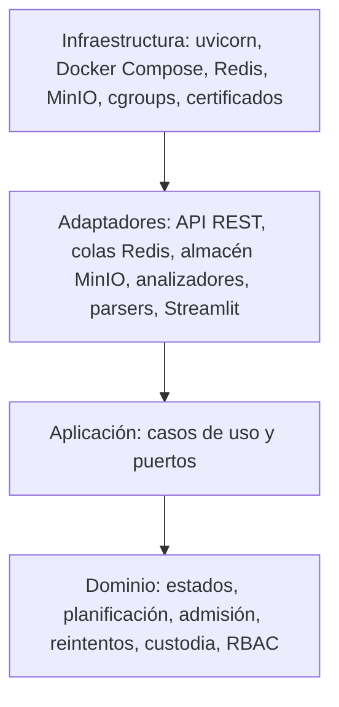
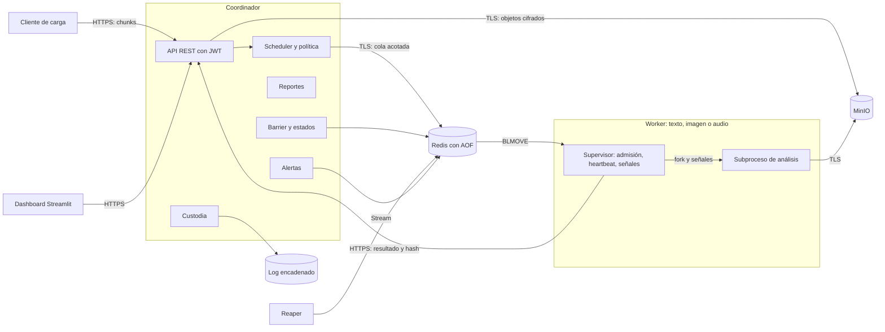
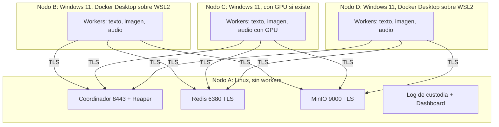
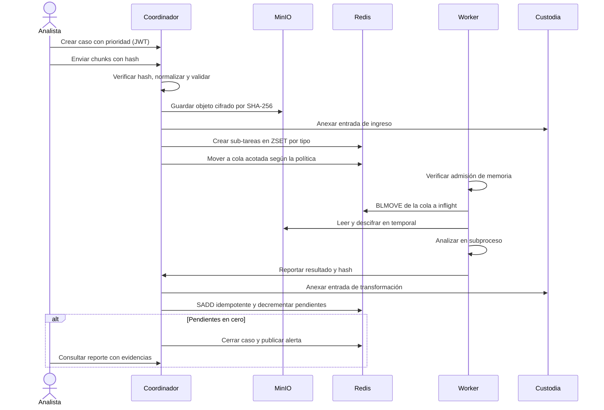
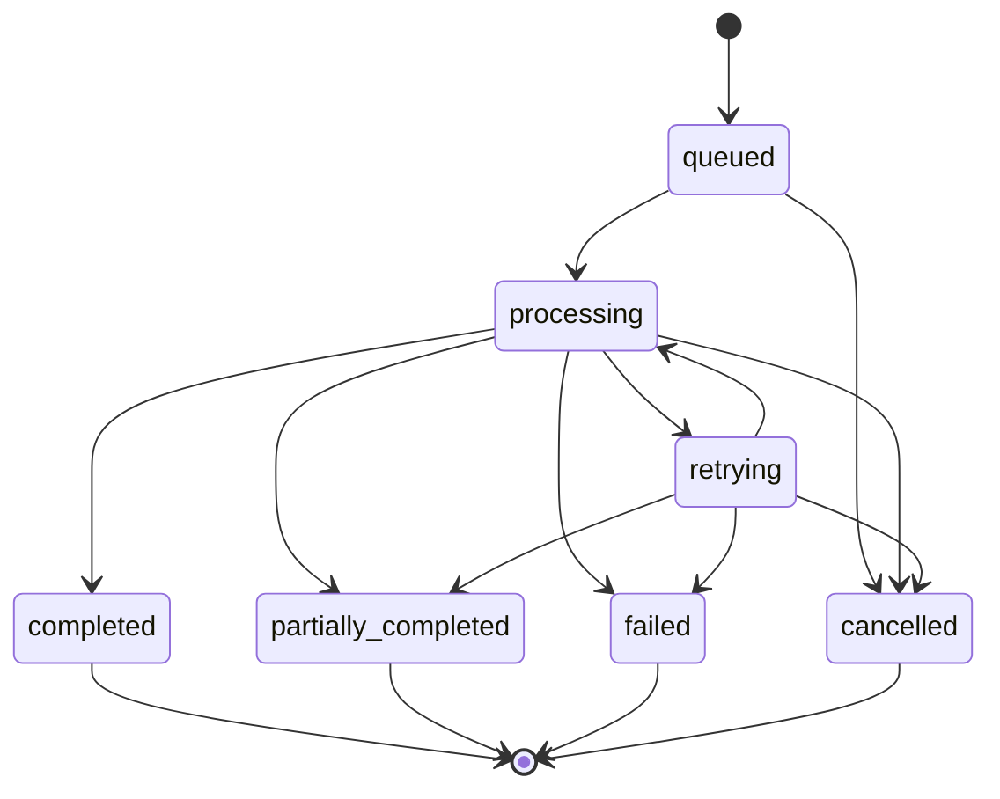

**Resumen:** Arquitectura ADD de un proyecto independiente que reutiliza código del I Proyecto (FastAPI, Redis, MinIO, workers *pull*), con límites de memoria, planificación con aging, E/S por chunks, seguridad y routing medido, en tres nodos worker.

# Arquitectura

Requisitos en `REQUERIMIENTOS.md`. **Ningún dato de rendimiento de este sistema se ha medido todavía.** Donde una decisión depende de una medición, se indica «Medición pendiente» y la ficha que la producirá. Toda decisión de ese tipo es provisional hasta tener el dato.

## 1. Código reutilizado del I Proyecto

Este proyecto es independiente: se justifica por su enunciado y reutiliza código porque [B.2] lo motiva. La tabla indica qué se toma y qué no. Origen: repositorio `nahum0804/distributed-processing-platform`, commit `bc6bab6` de `main`. Las limitaciones provienen de su `docs/DECISIONES_DISENO.md`.

| Elemento | Estado en el I Proyecto | Acción | Requisito |
|---|---|---|---|
| Coordinador FastAPI sin estado propio | Funciona; estado en Redis | Reutilizar y extender | RF-01, RF-44 |
| Barrier/join idempotente (`SADD`) | Funciona | Reutilizar | RF-10 |
| Heartbeat y reaper | Reencola en ~25 s (declarado, sin logs en `docs/evidencia/`) | Reutilizar y volver a medir | RF-43 |
| Consumo `BLPOP` + `WATCH/MULTI` | Ventana de pérdida de milisegundos | Modificar | RF-44, RNF-03 |
| Prioridad estricta `:high` | Admite inanición | Reemplazar | RF-29 |
| Cancelación | No detiene FFmpeg en curso | Reemplazar | RF-12 |
| Workers | Solo FFmpeg, sin modelos ni texto | Nuevo | RF-06 a RF-08 |
| Límites de memoria | No existen | Nuevo | RF-24 |
| TLS, autenticación | No existen; MinIO con credencial por defecto | Nuevo | RF-35, RF-36 |
| Dashboard Streamlit | Funciona | Reutilizar y extender | RF-17 |
| Evidencia en 3 máquinas | Pendiente; se probó en una sola | Obligatorio | RNF-01 |

## 2. Escenarios de atributos de calidad

| ID | Atributo | Estímulo | Entorno | Respuesta | Medida | Req. |
|---|---|---|---|---|---|---|
| QA-01 | Memoria por worker | Ráfaga que supera la capacidad de un worker | Nodo real con `memory.max` | Se admite lo que cabe; el resto espera en cola | `memory.current` por worker a lo largo del tiempo; sub-tareas admitidas contra rechazadas | M1 |
| QA-02 | Recuperación de OOM | Sub-tarea que excede el límite | Worker con límite reducido | Se detecta, se clasifica como `oom` y se reencola según la política | `oom_kill` en `memory.events`; estado final; tiempo de recuperación | M1 |
| QA-03 | Equidad sin inanición | Flujo sostenido de casos altos con casos bajos en espera | Scheduler con FIFO y con aging | Los casos bajos avanzan aunque siga llegando carga alta | Espera, turnaround y throughput por nivel; espera máxima de prioridad baja acotada | M2 |
| QA-04 | Throughput de E/S | Transferencia ≥ 200 MB | Red real entre nodos | Reensamblado correcto y verificado | MB/s para ≥ 3 tamaños de chunk; coincidencia de SHA-256 | M3 |
| QA-05 | Backpressure | Productores más rápidos que los consumidores | Ráfaga, con y sin límite | Se rechaza o bloquea al productor; la cola no crece sin límite | Profundidad de cola y tiempos de respuesta en el tiempo | M3 |
| QA-06 | Confidencialidad | Captura de tráfico o lectura directa del almacenamiento | Operación normal | Tráfico y objetos ilegibles sin llave | `tshark` muestra TLS; el objeto no contiene el texto original | M4 |
| QA-07 | Integridad de custodia | Alteración de una evidencia o de una entrada del log | Sistema detenido o activo | El verificador falla e indica la posición | Detección en cada manipulación probada | M4 |
| QA-08 | Control de acceso | Acción no permitida por el rol | API activa | Se deniega y se registra | 401 y 403 esperados por rol y acción | M4 |
| QA-09 | Routing por tipo de nodo | Sub-tarea de inferencia con nodos heterogéneos | Benchmarks completos | Se despacha según la tabla medida; hay alternativa si no hay nodo preferido | Latencia, throughput y memoria por configuración; decisión trazable | M5 |
| QA-10 | Rendimiento bajo ráfaga | ≥ 20 casos concurrentes | Tres nodos | Todos los casos alcanzan estado final | Throughput, latencia por caso, recursos por nodo | B.6 |
| QA-11 | Tolerancia a caída de worker | `docker kill` durante un caso | Tres nodos | Detección, reasignación y estado final correcto | Tiempo de detección y de reasignación; conteo de sub-tareas | B.6 |
| QA-12 | Recuperación del coordinador | Reinicio con casos en curso | Tres nodos | Continúa desde el estado persistido | Sub-tareas sin perder ni duplicar; tiempo de retoma | B.6 |
| QA-13 | Liberación de recursos | Cancelar un caso pesado en curso | Worker con sub-tarea activa | Mata procesos y libera memoria y temporales | Procesos, memoria y temporales antes y después; tiempo de liberación | B.6 |
| QA-14 | Estabilidad bajo saturación | Carga mayor que la memoria del nodo | Nodo con control de admisión | El nodo sigue operando | Heartbeats continuos; sin OOM del host | B.6, M1 |

## 3. Tácticas por atributo

| Atributo | Tácticas | Decisión |
|---|---|---|
| Memoria | cgroups v2 por contenedor; sin swap; control de admisión con huella medida; reencolado por OOM | AD-05, AD-06, AD-07 |
| Equidad | Prioridad con aging implícito; scheduler como política intercambiable | AD-04 |
| Rendimiento de E/S | Chunks de tamaño medido; almacenamiento por contenido; recepción no bloqueante | AD-10, AD-11, AD-13 |
| Disponibilidad | Colas acotadas; rechazo con `Retry-After`; heartbeat y reaper; idempotencia | AD-03, AD-12 |
| Recuperación | Coordinador sin estado; estado en Redis con AOF, que actúa como checkpoint; reconciliación al arrancar | AD-21 |
| Liberación de recursos | Sub-tarea en subproceso propio; señal a su grupo de procesos; temporales propiedad del supervisor | AD-08, AD-09 |
| Seguridad | TLS con CA privada; cifrado de sobre; log encadenado; JWT con roles; contenedores sin privilegios | AD-14 a AD-17 |
| Heterogeneidad | Routing por tabla derivada de benchmarks; alternativa si falta el nodo preferido | AD-18 |

## 4. Capas (Clean Architecture)

Las dependencias apuntan hacia el dominio. El dominio no importa `redis`, `fastapi`, `minio` ni modelos. Una prueba analiza los `import` para hacer cumplir esta regla.

| Capa | Ruta | Contenido |
|---|---|---|
| Dominio | `src/domain/` | `case_state`, `scheduling`, `admission`, `retry`, `oom_policy`, `routing`, `custody_chain`, `rbac`, `severity`, `chat_message`, `text_analysis`, `image_detection`, `chunks`, `transcription` |
| Aplicación | `src/application/` | `create_case`, `dispatch_next`, `report_result`, `cancel_case`, `build_report`, `verify_custody`, `analyze_text`, `analyze_image`, `chunked_upload`, `ports`, `analyze_audio` |
| Adaptadores | `src/adapters/` | `api/`, `redis_queue`, `redis_case_repository`, `minio_object_store`, `whatsapp_parser`, `telegram_parser`, `text_analyzer`, `spacy_hf_text_models`, `image_analyzer`, `yolo_detector`, `hashing`, `audio_analyzer`, `ffmpeg_media`, `disk_chunk_staging`, `whisper_transcriber` |
| Infraestructura | `src/infrastructure/`, `deploy/` | Composición, configuración, lectura de cgroups, TLS, Compose por nodo |

**Contratos compartidos.** Ver [CONTRATOS.md](CONTRATOS.md): definen cada punto de contacto entre módulos, con dobles en `tests/dobles.py` y pruebas de conformidad en `tests/contratos.py`.

**Coordinador.** `src/coordinator/` se divide en `rutas_casos`, `rutas_subtareas`, `rutas_monitoreo`, `modelos`, `conexion` y `apoyo`; `main.py` solo compone la aplicación.

**Código reutilizado.** No se reescribe en bloque, porque hay poco tiempo y sus pruebas son la red de seguridad. La lógica nueva nace en `domain` y `application`; el código reutilizado se mueve a `adapters` solo cuando se toca.

## 5. Diagrama de componentes

## 6. Diagrama de despliegue

Restricciones de despliegue:

- Cada contenedor worker tiene `mem_limit` igual a `memswap_limit`, de modo que el límite no se evade con swap.
- La suma de límites de un nodo no supera su RAM menos una reserva. Un script lo comprueba antes del arranque.
- **Cada tipo de worker debe existir en al menos dos nodos.** Sin eso, la caída de un worker no tiene a quién reasignar sus sub-tareas [B.6].
- El Nodo A concentra servicios. Es un punto único de falla aceptado: [B.6] solo exige reiniciar el coordinador, no alta disponibilidad.
- Las cuatro máquinas se comunican por Tailscale. **Tailscale no sustituye a TLS:** RF-36 exige una captura entre nodos que muestre TLS. Las flechas y los puertos del diagrama son el estado final, tras F-27.
- Los tres nodos worker operan con Docker Desktop sobre WSL2. Sus cgroups son los de la VM de WSL2. **Como ningún worker corre en un nodo Linux, la ficha M1 declara que los cgroups medidos son los de la VM de WSL2.** El Nodo A no ejecuta workers, tampoco para M1. Sin comprobar: que esa VM exponga cgroups v2, que es lo que suponen RF-24 y los comandos de medición de M1.

## 7. Flujo de un caso

## 8. Registro de decisiones

«Fuente» distingue referencia consultable de medición. Referencias en §10.

| ID | Decisión | Alternativas | Criterio de elección | Fuente |
|---|---|---|---|---|
| AD-01 | Reutilizar código del I Proyecto donde sirva, en un proyecto independiente | Escribir todo desde cero | [B.2] motiva reutilizar y evalúa lo nuevo; tiempo disponible | Medición del repo: 18 archivos, 387 funciones de prueba, 474 casos pasan y 3 se omiten |
| AD-02 | Cuatro máquinas físicas en Tailscale: servicios en el Nodo A y tres nodos worker | Tres máquinas con servicios y workers juntos en el Nodo A; VMs en un solo equipo; red local | [B.2] exige tres nodos worker en entidades separadas, de preferencia una computadora por integrante, y rechaza una sola máquina. El equipo tiene cuatro. Tailscale conecta máquinas que no compartan red local | [B.2]; SUP-04 |
| AD-03 | Redis con `BLMOVE` a lista `inflight:{worker}` | Redis Streams; RabbitMQ | Cierra la ventana de pérdida con el menor cambio; conserva `recovery.py` y reaper | R1; limitación declarada del I Proyecto. Entrega al menos una vez, compensada por AD-21. **F-06:** implementado para el camino nuevo de F-05 en `RedisTypeQueue` (`src/adapters/redis_type_queue.py`); `inflight:{worker_id}` es una *lista*, no un *set*, porque `BLMOVE`/`LMOVE` exigen listas en ambos extremos. El camino heredado (`worker_node.py`, `scripts/reaper.py`) sigue con `BLPOP`+`SADD` por separado y la misma ventana de pérdida sin cerrar: no se tocó por ser código en producción (F-07/F-08/F-09); queda como límite conocido para F-34 |
| AD-04 | ZSET por tipo con `puntaje = t_entrada − bono(prioridad)`, el menor sale primero | Prioridad estricta; WFQ; MLFQ | Aging implícito sin temporizadores: un caso de prioridad baja solo puede ser adelantado por casos que entren hasta `bono(crítica) − bono(baja)` después de él; la ventana limita qué llegadas posteriores pueden adelantarlo, no su espera total, que también depende del trabajo previo y del servicio. Selección O(log n) | R2 cap. 5; R3. Simulación F-21: mayor espera media por semilla de prioridad baja bajo aging 245.789 ms; el CSV no guarda máximos individuales y 400 ms no es una cota universal de espera. Comparación con FIFO y limitaciones en `docs/modulo-M2-planificacion.md` |
| AD-05 | Un contenedor por tipo de worker con `mem_limit`, sin swap | `systemd MemoryMax=`; un solo contenedor para todos | Reutiliza Compose; aísla un OOM a un tipo; cgroups v2 lo aplica el kernel | R4, R5; [B.5 M1] |
| AD-06 | Admisión en el worker antes de sacar de la cola: `memory.current + huella(modelo) ≤ memory.max × (1 − margen)` | Concurrencia fija; reservas en el coordinador | Encaja con el modelo *pull*: lo que no se saca sigue en cola y otro nodo puede tomarlo. No centraliza el estado de memoria | R4. **Medición pendiente:** huella de ficha M1 |
| AD-07 | Comparar carga independiente por proceso con pesos compartidos por CTranslate2 en un único proceso mediante `inter_threads`; elegir con datos, provisionalmente por proceso. **ADD F-19 (2026-11-10, autorización delegada por José):** se descarta fork de un modelo CTranslate2 ya cargado porque la prueba real Linux se bloqueó aunque se limitara a un hilo; no hay una API documentada de CTranslate2 para mapear sus pesos en memoria. Se conserva Whisper CPU, N=1/N=2 y supervisor incluido en PSS; no generalizar a texto/imagen. CTranslate2 documenta que sus workers comparten pesos y permite fijar `inter_threads`, proporcionando una alternativa soportada. Medición Docker Desktop Linux/WSL2, 4 GiB sin swap, n=5: a N=2, PSS promedio fue 281929728 bytes con `workers_compartidos` y 420311450 con `por_proceso`; se mantiene la estrategia compartida como elección provisional para esta carga. No representa un worker desplegado ni otros modelos. | `fork` tras cargar; carga independiente por proceso; `inter_threads` con pesos compartidos en una instancia; `mmap` propio | Evita heredar hilos nativos y mide una capacidad soportada por el backend. Se compara PSS de procesos independientes contra proceso y threads compartidos, con el mismo modelo/parámetros/carga; RSS no representa memoria física exclusiva. No se atribuye a mmap una API que CTranslate2 no documenta | CTranslate2, [parallelism](https://opennmt.net/CTranslate2/parallel.html); Python, [os.fork](https://docs.python.org/3.14/library/os.html#os.fork); R2 cap. 10; R4; evidencia en `docs/specs/F-19/QA-parte-3.md` |
| AD-08 | Cada sub-tarea corre en un subproceso con grupo propio; el supervisor es dueño de sus temporales | Hilos (actual); sin aislamiento | Un hilo de Python no se puede matar desde fuera. Si un hijo recibe `SIGKILL` no puede limpiar: debe hacerlo el padre. Un OOM del hijo no mata al supervisor | R2 cap. 3; limitación declarada del I Proyecto |
| AD-09 | Cancelación con clave `cancel:{caso}` y `PUBLISH`; `SIGTERM`, gracia, `SIGKILL`, `waitpid` | Solo Pub/Sub; solo sondeo | Pub/Sub aporta inmediatez pero no persiste; la clave cubre al suscriptor que estaba reconectando | R1 |
| AD-10 | Protocolo propio por chunks; tamaño fijado con datos, provisional 4 MiB | Subida directa a MinIO; protocolo tus | Permite medir y variar el chunk [B.5 M3]; simple de explicar | **Medición pendiente:** ficha M3, 256 KiB, 1 MiB, 4 MiB y 16 MiB |
| AD-11 | Dedup a nivel de archivo, clave SHA-256 del texto en claro | Chunks de tamaño fijo o variable | Mantiene separados los experimentos (SUP-13). El hash del contenido en claro es necesario, porque el cifrado aleatorio impide deduplicar sobre el texto cifrado. Revela si dos objetos son iguales: riesgo aceptado y declarado, porque el acceso al almacén es restringido | R9 (nonce aleatorio en GCM). **Medición pendiente:** tasa en ficha M3 |
| AD-12 | Dos niveles: API responde 503 con `Retry-After`; scheduler mueve solo si `LLEN < límite`, con script Lua atómico | Bloquear al productor; colas sin límite | Rechazar no retiene conexiones. El bloqueo en el scheduler conserva el orden de prioridad en el ZSET. Un parámetro desactiva el límite para el experimento | R1. **Medición pendiente:** ficha M3 |
| AD-13 | Recepción `async` en uvicorn; escritura en hilo acotado | Escritura síncrona; servicio separado | Reutiliza FastAPI; no bloquea el bucle de eventos | R7. **Medición pendiente:** RF-34 |
| AD-14 | JWT firmado con rol y `Depends` de FastAPI | Sesiones; Keycloak | Sin estado y sin un servicio más; B.7 lo sugiere | [B.7 Seguridad]; R2 cap. 16 y 17 |
| AD-15 | TLS 1.3 con CA privada y certificado por nodo, en API, Redis y MinIO | WireGuard; malla de servicios | La captura muestra TLS, como pide la evidencia; lo soportan los tres componentes de forma nativa | R8; [B.7 Seguridad] |
| AD-16 | AES-256-GCM en la aplicación, llave por objeto (DEK) envuelta por una KEK en archivo montado, permisos `0400`; nonce único por chunk | MinIO SSE; LUKS; Vault | Protege también contra quien lee MinIO. Vault agrega un servicio que operar con el tiempo disponible. Limitar a una DEK por objeto evita el límite de nonces aleatorios por llave | R9; [B.7 Seguridad] |
| AD-17 | JSONL de solo-anexión con `entry_hash = SHA-256(prev_hash ‖ datos)`, un solo escritor con `O_APPEND` y `fsync`; cabeza sellada con HMAC | Log en Redis; Merkle; blockchain | Es lo que pide [B.5 M4]. **Una cadena sin llave se puede recalcular por completo y no detecta truncamiento: el sello HMAC lo cubre** | R10 |
| AD-18 | Tabla `config/routing.yaml` generada del benchmark; colas por clase de nodo; alternativa si no hay nodo vivo | Estimación dinámica; asignación manual | [B.5 M5] exige que la decisión provenga de datos; una tabla es trazable y explicable | **Medición pendiente:** ficha M5 |
| AD-19 | faster-whisper, YOLO (variante nano), spaCy y un modelo preentrenado de HuggingFace para sentimiento y ofensas | Modelos mayores; Vosk | Pesos pequeños para el límite de memoria; variantes `int8` para M5; [B.7] los sugiere. Ultralytics usa AGPL-3.0: se cita. Modelos definitivos sujetos a medición | [B.7 Texto/Imagen/Audio]. **Medición pendiente:** ficha M1 |
| AD-20 | Extender el dashboard Streamlit; datos de cgroups en el heartbeat | Prometheus y Grafana | Reutiliza código; evita servicios y TLS adicionales. Los gráficos de las fichas salen de CSV producidos por scripts | [B.2]; R4 |
| AD-21 | Coordinador sin estado, Redis AOF como checkpoint; `SADD` idempotente; reconciliación al arrancar | PostgreSQL; snapshots propios | Ya funciona. Con `appendfsync everysec` un fallo de **Redis** puede perder hasta 1 s; [B.6] exige reinicio del **coordinador**, no de Redis | R1. I Proyecto declaró 45 s detenido sin pérdida, sin logs: **Medición pendiente**, F-35 |
| AD-22 | Imágenes de workers ML con Python 3.13, igual que CI; la imagen heredada usa `3.14` | 3.12; mantener 3.14 | El código heredado usa `os.process_cpu_count`, disponible desde 3.13, así que 3.12 no sirve. Las dependencias nativas de inferencia pueden no publicar *wheels* para 3.14 | `src/workers/config.py:176`; CI. Verificar *wheels* al construir la imagen |
| AD-23 | Compose fija `hostname` con `NODE_NAME` y el heartbeat publica `NODE_IP`, la IP de Tailscale de la máquina | `network_mode: host`; usar solo `host` y capturar la IP aparte | En contenedor, `hostname` es el ID del contenedor y `ip` es la IP bridge: tres réplicas en un equipo darían tres `hostname` y no probarían [B.2], y RNF-01 no se podría demostrar en `GET /workers`. `network_mode: host` en Docker Desktop actúa sobre su VM, no sobre Windows. Consecuencia: `--scale` deja de ofrecerse y cada servicio de un nodo necesita su `WORKER_ID` | RNF-01; `src/workers/heartbeat.py:88` y `:148`. Comportamiento de `network_mode: host` tomado de la documentación general de Docker, sin probar. Aprobada por Kenni. F-38 |
| AD-24 | Coordinador en el Compose del Nodo A | Proceso nativo | US-38 pide levantar el Compose de cada nodo; [B.8] menciona Docker Compose por nodo | US-38; [B.8]. Aprobada por Kenni. F-38 |
| AD-25 | Generador nuevo y determinista del dataset sintético (`scripts/dataset_sintetico.py`, con plan, chats, `ffmpeg` y manifiesto con validador) | Ampliar `scripts/build_dataset.py` | RF-18 a RF-22 exigen texto e imágenes y reproducibilidad; `build_dataset.py` solo cubre video y audio, no tiene texto ni imágenes y su manifiesto trae `generated_at`, que no es reproducible. Misma semilla, mismo plan y manifiesto planeado (los hash de archivo dependen de la versión de `ffmpeg`). Licencia MIT, origen `sintetico`. Detalle en [dataset.md](dataset.md). Aprobada por la persona | `docs/specs/F-03/SPEC.md`; [B.3]. FFmpeg, ffmpeg.org. F-03 |
| AD-26 | Análisis de texto por lote: palabras clave por frecuencia de lemas de spaCy; tema por léxico configurable; sentimiento y ofensa con un modelo preentrenado de HuggingFace; amenaza por patrones del `Matcher` de spaCy; severidad por reglas en TOML | Clasificación temática *zero-shot* con un modelo NLI; amenaza solo con un clasificador de toxicidad; un LLM | Un solo modelo grande cabe mejor en el límite de memoria (AD-06); léxico y patrones son explicables y se ajustan sin entrenar (RNF-25); coincide con el recorte 4 de IMPLEMENTACION §1.3. **Provisional:** plan de F-07 aprobado por José Andrés. La parte 1 implementa, con modelos falsos, la severidad por reglas en `config/texto.toml` con regla de `amenaza` obligatoria (SUP-07) y umbrales validados en [0, 1]; el tema por léxico comparado sin tildes ni mayúsculas (la `ñ` se compara como `n`), y el rechazo de un modelo que no devuelva un análisis por mensaje. La parte 2 fija los modelos en `config/texto.toml`: spaCy `es_core_news_sm` 3.8.0 (GPL-3.0) para lemas y `Matcher`; `pysentimiento/robertuito-sentiment-analysis` y `pysentimiento/robertuito-hate-speech` con revisión fijada, entrenados con datasets de uso no comercial, admitido solo por el uso académico (R11, R12). El puntaje de ofensa es el máximo de `hateful` y `aggressive`; `targeted` no cuenta, porque indica a quién va el mensaje y no si ofende. Los patrones de amenaza comparan `LOWER`, no `LEMMA`, para no depender del lematizador ante mayúsculas. La parte 3 ejecutó por primera vez los modelos reales el 2026-11-07, con lotes de 10 mensajes sobre una conversación sintética de 40 mensajes redactada con IA: tema 4/4, sentimiento 4/4, amenaza 1/1, ofensivo 1/1 y sin ofensa 2/2 ([docs/evidencia/F-07_aciertos_2026-11-07.md](evidencia/F-07_aciertos_2026-11-07.md)). Es una medición funcional, de punta a punta, no de precisión: la muestra es pequeña y la conversación se redactó conociendo el léxico y los patrones. Las pruebas exploratorias de QA mostraron que el modelo de odio no detecta la mayoría de insultos genéricos, que los patrones no detectan amenazas sin patrón y que la ironía se lee como positiva. El patrón `vas_a_ver` quedó en «vas» y «van», porque «voy» y «vamos a ver» daban amenazas altas falsas. AD-25 queda para la rama de F-03 | [B.7 Texto]; AD-19; SUP-07. **Medición pendiente:** calidad sobre datos etiquetados independientes (F-04), calibración de `umbral_ofensa` y de los umbrales de severidad, que siguen provisionales en 0.5 porque, en la exploración de QA, los puntajes de ofensa de la muestra quedan en 0.133 o menos y en 0.981 o más, sin valores intermedios con que calibrar, y huella de F-17 |
| AD-27 | Detección de contenido sensible en imagen con Ultralytics YOLO11n preentrenado en COCO, solo inferencia en CPU; clases sensibles por mapa en `config/imagen.toml` (inicialmente `knife` → `arma`, SUP-22); un hallazgo por categoría con la detección de mayor confianza y su caja como posición; severidad con las reglas de F-07 | Clasificador de imagen completo (ImageNet o NSFW de HuggingFace); pesos YOLO ajustados por terceros para armas de fuego; OpenCV DNN con ONNX | Un solo modelo pequeño para el límite de memoria (AD-06); la caja da la posición que pide RF-14; COCO trae `knife`, que cubre el arma en imagen de SUP-07 sin entrenar (RNF-25); los pesos de terceros para armas de fuego tienen licencia y procedencia dudosas. Ultralytics y sus pesos usan AGPL-3.0, compatible con el repositorio público; se cita (Parte I §9). **Provisional:** plan de F-08 aprobado por José Andrés, con YOLO11n y `knife` → `arma`. La parte 1 implementa, con un detector falso, la conversión de detecciones en hallazgos: filtro por mapa y umbral mínimo inclusivo, un hallazgo por categoría con la detección de mayor confianza (desempate por caja) y `caja x1,y1,x2,y2` como posición; regla de `arma` obligatoria, y `SeverityRules` rechaza con `ValueError` reglas duplicadas, campos faltantes o una sección que no sea lista, lo que también aplica al texto de F-07. La parte 2 agrega `YoloDetector`, que infiere en CPU, convierte la salida a tipos nativos y rechaza con `ValueError` una imagen ilegible; fija en `config/imagen.toml` los pesos `yolo11n.pt` de la release v8.4.0 de ultralytics/assets con su SHA-256, que se comprueba antes de cargarlos, y `ultralytics==8.4.208` con `torch==2.15.0` CPU en `requirements-imagen.txt` (R13). Rechaza además cajas invertidas y etiquetas vacías, copia el mapa de clases y exige `[clases]` y `umbral_minimo`. La parte 3 ejecutó YOLO real por primera vez el 2026-11-09, en Python 3.14.0 y no en el 3.13 de AD-22, sobre 20 fotos propias de José Andrés con un mismo cuchillo: `arma` VP 4, FP 0, FN 6, VN 10 con `umbral_minimo = 0.25` ([docs/evidencia/F-08_aciertos_2026-11-09.md](evidencia/F-08_aciertos_2026-11-09.md)). Es una medición funcional, de punta a punta, no de precisión. Los 6 fallos tienen el cuchillo en vertical; en 3 YOLO detecta `tie` y en 2 `knife` con 0.15, bajo el umbral, que José Andrés mantuvo en 0.25 para no calibrar con la misma muestra. Una imagen que no decodifica da lista vacía con aviso en ultralytics 8.4.208, y `YoloDetector` la convierte en `ValueError`. AD-25 y AD-26 quedan para F-03 y F-07 | [B.7 Imagen]; AD-19; SUP-07. Ultralytics, docs.ultralytics.com. **Medición pendiente:** calidad sobre datos etiquetados independientes, con más de un cuchillo, calibración de `umbral_minimo` y huella de F-17 |
| AD-28 | Transcripción con faster-whisper `base` preentrenado, CPU e `int8`, idioma `es` fijo; un hallazgo `transcripcion` por segmento con su texto y timestamps; los segmentos pasan como mensajes por el análisis de texto de F-07 (AD-26), con posiciones de segmento y timestamp | Vosk; whisper de OpenAI sobre torch; modelo `tiny` o `small`; analizar la transcripción completa como un solo mensaje | faster-whisper es el que fija AD-19; usa CTranslate2 sin torch (AD-06, F-17); `int8` es la variante que compara M5 y `base` coincide con el comando de F-31; reutiliza F-07 sin duplicarlo y da el timestamp de RF-14. faster-whisper (SYSTRAN) y los pesos de Whisper (OpenAI) usan licencia MIT; se citan (Parte I §9). **Provisional:** plan de F-09 aprobado por José Andrés, con faster-whisper `base` y un hallazgo por segmento. La parte 1 implementa, con un transcriptor falso, `TranscriptSegment` con tiempos finitos y `0 <= inicio <= fin` y confianza validada en [0, 1]; un hallazgo `transcripcion` de severidad baja por segmento no vacío, con los segmentos renumerados tras descartar los vacíos; el análisis de F-07 reutilizado con el parámetro `posiciones` de `analyze_conversation`, que da `segmento i t=a-bs`, `segmentos i-j t=a-bs` y la lista `segmentos i,j t=a-bs,c-ds`; una nota sin voz da lista vacía. La parte 2 agrega `WhisperTranscriber`, que transcribe en CPU con importación diferida de faster-whisper y carga el modelo una vez por instancia; fija en `config/audio.toml` la revisión de `Systran/faster-whisper-base` como commit de 40 dígitos hexadecimales, exige un `idioma` que sea uno de los 100 códigos de Whisper copiados de `_LANGUAGE_CODES` de faster-whisper v1.2.1, sin espacios ni mayúsculas, y rechaza con `ValueError` cualquier valor que no sea texto, acepta solo `compute_type` `int8` o `float32` y con `hilos = 0` delega el número de hilos en CTranslate2; `faster-whisper==1.2.1` va en `requirements-audio.txt` (R14). Convierte la salida a tipos nativos, calcula la confianza como `exp(min(0, avg_logprob))` y rechaza un `avg_logprob` NaN, y ordena los segmentos por inicio. Ante un audio ilegible lanza `ValueError` con la ruta: captura `OSError`, `ValueError`, el `IndexError` de un archivo sin pista de audio y `av.error.FFmpegError`, según el código fuente de PyAV 19.0.2; la parte 3 confirmó con PyAV 18.1.0 real que un archivo que no es audio, uno vacío y un mp4 sin pista de audio dan `ValueError`. `MemoryError`, `TimeoutError`, `BlockingIOError`, `InterruptedError` y `PermissionError`, incluidos los de `av.error` que también heredan de `FFmpegError`, se propagan sin convertirse, porque son transitorios y F-12 y F-18 pueden reintentar; `FileNotFoundError` y otros `OSError` siguen dando `ValueError` `TranscriptSegment` rechaza además tiempos `bool` y mayores que el rango de `datetime`. La parte 2 no ejecutó faster-whisper real; la parte 3 sí lo ejecutó. La parte 3 agrega `scripts/comparar_transcripcion.py`, que transcribe una muestra de 5 notas propias con su transcripción esperada, calcula la tasa de error por palabra (WER) tras normalizar mayúsculas, tildes (con la `ñ` conservada) y puntuación, la registra sin umbral y escribe la tabla en `docs/evidencia/`, con una sección de límites de texto fijo; los errores de entorno salen como `error:` con código 1. La comparación se midió el 2026-11-10 con faster-whisper 1.2.1, av 18.1.0 y los pesos `base` fijados (Python 3.14, CPU, `int8`), sobre 5 notas propias y sintéticas: WER de 15.4, 9.1, 36.4, 27.3 y 0.0 %, en `docs/evidencia/F-09_transcripcion_2026-11-10.md`. Límites medidos: `amenaza_01` es un falso negativo (Whisper `base` oyó «más a ver» en vez de «vas a ver»); un tono sostenido de 35 s produce un segmento inventado de `...` que el adaptador acepta; no se normalizan números; la muestra no es representativa. `requirements-audio.txt` fija `av==18.1.0` porque faster-whisper 1.2.1 falla con PyAV 19.0.2 | [B.7 Audio]; AD-19; SUP-07. **Medición pendiente:** huella de memoria de F-17. La comparación de transcripción de F-09 está medida (parte 3) |

| AD-29 | **Aprobada en el plan de F-16 por José Andrés Loría Herrera (2026-11-10):** rechazar `memory.max = max`, cgroups ausentes y configuración inválida; exigir límites y reserva explícitos sin valores numéricos predeterminados | Aceptar memoria ilimitada; omitir el chequeo ante errores; fijar límites por estimación | Evitar que un error de lectura permita arrancar sin el límite de RF-24; conservar parámetros calibrables y trazables. SUP-23; no cambia el contrato `ResourceReader`. Parte 1 implementa lector y validación pura; cableado de arranque pendiente en parte 2. Ficha: [M1](modulo-M1-memoria.md) | [B.5 M1]; RF-24; AD-05; SUP-17. **Medición pendiente:** límites, reserva y RAM efectiva de WSL2 |
| AD-30 | Control de admisión antes de `blpop` en `Worker.poll_once`: se lee `ResourceReader` y solo se consume una sub-tarea si `admits(current, max, footprint, margin)` cabe con la huella mínima de las colas que atiende; si no cabe o la lectura falla, se espera (`stop_event.wait`) y se registra; huellas y margen vienen de configuración (`FOOTPRINT_<OP>_BYTES`, `ADMISSION_MARGIN_BYTES`) sin valores predeterminados | Sacar la sub-tarea y reencolarla (riesgo de pérdida y reordenamiento); huella global fija; valores por defecto estimados | `blpop` multi-cola extrae al llamarse, así que la compuerta debe ir antes; coherente con AD-29 (no omitir el chequeo ante errores). La reserva de memoria de una sub-tarea reencolada por OOM se suma a la huella mientras corre (SUP-14, F-18). Limitación conocida: con `memory.max = max` el lector lanza `ValueError` y el worker nunca admite (se registra cada ciclo); F-16 exige límite. Estado: propuesta, pendiente de aprobación de José Andrés Loría Herrera. Ficha: [M1](modulo-M1-memoria.md) | [B.5 M1]; RF-25; US-17; AD-29. **Medición pendiente:** huella por tipo de operación |
| SUP-24 | Reserva provisional del preflight: máximo entre 1 GiB y 15 % de `MemTotal`; obtener bytes con `docker info --format '{{.MemTotal}}'` desde el daemon Linux que aplica los límites | Reserva cero; porcentaje fijo; consultar `/proc/meminfo` desde un proceso dentro de WSL2 | El preflight ya requiere el daemon para Compose; su CLI reporta la memoria de la VM Linux también cuando Python se ejecuta desde PowerShell en Windows, y evita confundirla con la RAM física del host | Ajuste de método en F-16 parte 2 tras confirmar que B/C/D se operan desde PowerShell y que `/proc/meminfo` no existe para Python de Windows. **Provisional; validar la salida del daemon y la reserva con mediciones reales.** |
| AD-31 | El worker cancela el grupo de procesos del caso: `SIGTERM`, espera la gracia (`grace_seconds`, 10 s por defecto), `SIGKILL` si sigue vivo, recoge el proceso y borra su directorio `/scratch`. La orden llega por Redis (`cancel:*`) y la subtarea queda `cancelled` (caso `case_cancelled`) | Solo `SIGKILL`; sin gracia; borrar sin esperar la salida | Permite que FFmpeg cierre, sin zombies ni temporales (RF-12, RNF-03). La gracia debe ser menor que `stop_grace_period` (31 m en `deploy/docker-compose.worker.yml`, F-16); si no, Docker mata el worker antes de limpiar. **F-36 parte 1:** `process`, `_run` y `main()` (solo POSIX) cablean el `ProcessSupervisor` en `multimedia_processor.py` y `worker_node.py`; `cancel` es idempotente. La evidencia con worker y Redis en nodos reales es «Medición pendiente» (F-36 parte 2, depende de F-38) | RF-12; RNF-03; [evidencia F-12](evidencia/F-12_cancelacion_2026-11-10.md) |
| AD-32 | Routing por tipo de nodo: `RoutingTable` (dominio, implementa `RoutingPolicy`) guarda para cada `ContentKind` una lista ordenada de clases (preferida primero, luego alternativas). `route` devuelve la primera clase viva o lanza `NoLiveNodeClass` (`ValueError`) sin mutar la sub-tarea. La tabla está en `config/routing.toml` (`[rutas]`, con `[evidencia]`), la carga `src/adapters/routing_config.py` con `tomllib` y se valida al arranque: rechaza una ruta escrita como cadena, tipos desconocidos, listas vacías, clases vacías o duplicadas. Valores provisionales: audio `gpu` y luego `cpu`; texto e imagen `cpu`. **Medición pendiente:** valores en nodos WSL2 reales (F-38) y GPU | Elegir clase por carga instantánea del nodo (acopla con M1 y no es reproducible); codificar la preferencia en el coordinador (no cita la medición de F-31); heurística dinámica | Tabla estática, auditable y reproducible; cambiar un valor exige editar configuración y pasar la validación, sin tocar código. El coordinador (M2) debe invocar `route`; `docs/CONTRATOS.md` no cambia. Ficha: [M5](modulo-M5-computo.md) | RF-41; B.5 M5; SPEC F-32; medición F-31 |
| AD-33 | Autenticación con JWT HS256 y secreto fuera del repo (`JWT_SECRET_FILE` o `JWT_SECRET`, mínimo 32 bytes); algoritmo fijado en la verificación; claims `sub`, `role`, `iat`, `exp`. Cuarto rol técnico `servicio` para los workers, que solo puede `reportar_subtarea`. Matriz rol-acción pura en `src/domain/rbac.py`; el mapa ruta-acción vive en `seguridad.py` y una prueba exige que toda ruta esté clasificada | Basic auth (sin expiración ni roles firmados); API keys por rol en Redis (estado a operar, sin expiración); RS256 (dos llaves sin necesidad hoy); mTLS (lo cubre F-27 para nodos, no identifica rol de usuario); dejar `POST /subtasks/report` abierta (endpoint sin protección) | Un solo emisor y verificador, así que una llave simétrica basta; sin `servicio`, proteger `POST /subtasks/report` rompería a los workers. **Provisional:** decisión de la persona pendiente. Parte 1 implementa solo `Role`, `Action`, `PERMISOS` y `can` (falla cerrado ante cualquier tipo que no sea `Role`/`Action`); JWT y cableado en las partes 2 y 3. PyJWT (MIT) se cita en la parte 2 | [B.5 M4]; RF-35; RNF-12; SUP-28; SUP-29. Medición pendiente: no aplica |
| AD-34 | Cifrado de sobre AES-256-GCM por chunks (`src/adapters/envelope_cipher.py`). DEK de 32 bytes por objeto (`os.urandom`), envuelta con la KEK (AES-256-GCM, nonce propio, SHA-256 del claro como AAD). Nonce de chunk de 12 bytes: prefijo aleatorio de 4 B (en la cabecera) más contador de 8 B. AAD de chunk: cabecera fija (magia, versión, tamaño de chunk, prefijo) + SHA-256 + índice + marca de último, de modo que reordenar, duplicar o truncar falla. Tamaño de chunk 4 MiB por defecto y tope `MAX_CHUNK_SIZE` de 64 MiB, que `decrypt` también exige a la cabecera. `decrypt` entrega chunks ya autenticados y lanza `DecryptionError` en el chunk alterado; los anteriores ya se entregaron. Sin KEK válida lanza `KeyUnavailable` | Nonce aleatorio de 96 bits por chunk (unicidad solo probabilística); AES-GCM-SIV (complejidad sin necesidad con DEK por objeto); AES Key Wrap (RFC 3394) para la DEK | Con una DEK por objeto, el contador da unicidad exacta del nonce; el AAD detecta truncamiento y reordenamiento que GCM solo no detecta; memoria acotada a un chunk. Cifrar no oculta el tamaño del objeto. Estado: provisional. Fuente: NIST SP 800-38D §8.3. SPEC F-28; AD-10; AD-11; AD-16. **Medición pendiente:** tamaño de chunk y costo de CPU |
| AD-35 | Cadena de custodia con HMAC-SHA-256 por eslabón (`entry_hash = HMAC(llave, prev_hash ‖ JSON canónico)`), que precisa AD-17: el sello no está solo en la cabeza. Un ancla `<log>.head` con MAC detecta el truncamiento; el adaptador escribe un ancla génesis (`seq` 0, `GENESIS_HASH`, con MAC) al crear el log, de modo que sin ancla con entradas es siempre violación. La llave (`CUSTODY_KEY_FILE`, 32 bytes, fuera del repositorio) es distinta de la KEK de F-28. `verify_chain` (dominio) reporta la primera violación (línea base 1) sin lanzar ante líneas manipuladas; el adaptador `JsonlCustodyLog.record` verifica solo las últimas 2 líneas y el ancla (`verify_tail`), y el verificador completo detecta la manipulación intermedia | SHA-256 sin llave (se recalcula entera y no detecta reescritura); Ed25519 (el verificador no forja, pero exige gestionar un par de llaves); firma solo de la cabeza (no ubica la alteración) | Con la llave solo en escritor y verificador, reescribir la cadena exige la llave y el ancla delata el truncamiento. Límites en SPEC F-29: HMAC simétrico permite forjar a quien tenga la llave; ancla repuesta junto con log truncado no se detecta en el mismo disco, y la ancla génesis, determinista por llave, copiada oculta el truncado a 0 o 1 entradas (SUP-31; alternativa no hecha: nonce por log). Estado: provisional. **Medición pendiente:** costo de HMAC por entrada | AD-17; R10; [B.5 M4]; SPEC F-29; SUP-31 |
| AD-36 | Workers sin privilegios (provisional): `user: "10001:10001"` numérico, `read_only: true`, `cap_drop: [ALL]` sin `cap_add`, `security_opt: [no-new-privileges:true]`, volumen `scratch` propio por worker en `/scratch` (`WORK_DIR`, sin `tmpfs` por el cgroup) y `tmpfs` `/tmp:size=64m,mode=1777`. Alternativas descartadas: solo `USER` del Dockerfile (no demuestra raíz de solo lectura ni capacidades); rootless Docker o `userns-remap` (cambia el host de cada nodo, fuera del enunciado); seccomp personalizado (costo alto sin que el enunciado lo pida). Criterio: cumple literalmente US-30 [B.5 M4] con configuración por contenedor. Fuente: documentación de Docker Engine (`--read-only`, `--cap-drop`, `--security-opt`). Medición pendiente: que FFmpeg y una sub-tarea completa funcionen con esta configuración en los tres nodos. |
| AD-37 | TLS de servidor con verificación de la CA privada y del hostname en el cliente, en la API (8443), Redis (6380) y MinIO (9000); sin mTLS: la identidad del worker ante la API la da el JWT con rol `servicio` de F-26, y ante Redis y MinIO su credencial. `src/infrastructure/tls.py` exige TLS 1.3 como mínimo en `client_context`, `redis_kwargs` y `minio_http_client`; `requests_session` usa `trust_env=False` y `verify` fijo (ignora `REQUESTS_CA_BUNDLE`, proxies y `.netrc`) y bloquea la redirección de https a un esquema en claro; `exigir_cifrado` rechaza `http://`, `redis://` y `MINIO_SECURE=false` con TLS activo. Provisional | mTLS en todo (MinIO no valida certificados de cliente en la API S3, exige un certificado por worker y duplica el JWT `servicio`); mTLS solo en API y Redis (endurecimiento posible si sobra tiempo); solo TLS sin verificar el certificado (permite suplantar al servidor, rechazado); WireGuard o Tailscale como único cifrado (descartado en AD-15: la captura debe mostrar TLS) | Cubre RF-36 y el criterio «un cliente sin la CA es rechazado» con el mínimo de llaves por distribuir. JWT dice quién llama; TLS protege el canal y autentica al servidor. Límite: `requests_session` no impone TLS 1.3 mínimo y uvicorn y MinIO no exponen versión mínima por parámetro. Ficha: [M4](modulo-M4-seguridad.md) | RF-36; US-27; [B.5 M4]; AD-15; SPEC F-27; RFC 8446 (R8); RFC 6125 y RFC 9525. **Medición pendiente:** costo de TLS sobre el throughput de M3 |
| AD-38 | El reporte consolidado se calcula bajo demanda desde `FindingStore`, `CaseCatalog` y `ObjectStore.exists`; no se materializa al cerrar el caso. Dominio (`evidence_position.py`, `consolidated_report.py`) puro y sin E/S. Límites declarados de la parte 1: las posiciones que se leen son las que emiten hoy los analizadores; un rango de lote (`mensajes 0-49`) es posición de resumen y no de evidencia; una posición no reconocida queda como `UnknownLocator` y sale como incidencia; el evento sin hora absoluta (audio, imagen) va aparte en `sin_marca_absoluta`, sin inventar hora; un índice repetido en `detail` es ambiguo y se deja sin marca; las incidencias son de 7 clases (`severidad_alta`, `subtarea_fallida`, `evidencia_sin_fuente`, `objeto_inexistente`, `almacen_no_verificable`, `hallazgos_ilegibles`, `posicion_desconocida`; las dos nuevas son de las correcciones posteriores a la parte 3). Límites declarados de la parte 2: el extracto solo se arma para la categoría `transcripcion`, con tope `MAX_EXCERPT_CHARS=10_000` y marca de truncado; un almacén de objetos caído (`ObjectStore.exists` que lanza) deja `Fragment.in_store` en `None` y se reporta como `almacen_no_verificable`, distinto de `objeto_inexistente` (`in_store=False`); una evidencia sin `sha256` no consulta el almacén; los surrogates sueltos se sustituyen por «?»; la fuente se une por `sha256` o `file_path` (un `sha256` vacío no une); el catálogo expone `file_path` por diseño, de modo que un adaptador que lo llene con rutas absolutas las filtraría al reporte; `generated_at` va en UTC. Límites declarados de la parte 3: `obtener_almacen` responde 503 «pendiente F-23» hasta que Melany aporte un adaptador `ObjectStore` (la ruta real no sirve en producción hasta entonces); los workers de José aún no persisten `Finding` (la lista `case:{id}:findings` queda vacía hasta que cableen la escritura; F-13 entrega el adaptador); el hash de subtarea no trae `source_sha256` (la fuente se une por `file_path`) ni `kind` (se lee `task_type`); los hallazgos corruptos se omiten con un warning y se reflejan como una incidencia `hallazgos_ilegibles` con el recuento, vía el puerto opcional `OmissionAwareFindingStore.list_with_omitted` (no cambia `FindingStore`; un almacén que no lo implemente no reporta omisiones); `case_id` debe encajar `[A-Za-z0-9_-]{1,128}`; cualquier `redis.exceptions.RedisError` responde 503 con un detalle fijo, sin host, puerto ni texto de la excepción; sin paginación ni tope de hallazgos (20000 ≈ 11,7 MB); el `error_type` escrito por un worker pasa tal cual a las incidencias; la ruta debe clasificarse en la matriz de permisos de F-26 al fusionarse esa feature (aún no está en esta base); la parte 3 editó `build_report.py` de la parte 2. El JSON de ejemplo `docs/ejemplos/F-13_reporte_consolidado_ejemplo.json` es sintético y lo genera la prueba de aceptación con `F13_EJEMPLO_JSON`. Estado: propuesta, provisional | Materializarlo al cerrar el caso (exige un gancho en el barrier de Nahúm y queda desactualizado si un hallazgo llega tarde); guardarlo en el almacén de objetos (copia mutable de la evidencia, fuera de F-29) | La evidencia sigue siendo la referencia al objeto original y el reporte es una vista reproducible. Costo: se recalcula en cada consulta (**Medición pendiente:** solo si el reporte lo exige; no es medición de SO). Ficha: [SPEC F-13](specs/F-13/SPEC.md) | RF-14; US-13; SUP-34; SPEC F-13 |
| AD-39 (provisional) | Las alertas se publican en un Redis Stream acotado (`MAXLEN ~`) y se leen sin grupo de consumidores; el aislamiento de fallo vive en `SafeAlertPublisher` y la incidencia alta se detecta al agregar hallazgos con `AlertingFindingStore`, decorador de `FindingStore`. Alternativas: Pub/Sub de Redis (sin retención, una alerta sin lector se pierde); lista con `LPUSH`/`LTRIM` (sin identificadores ni orden por tiempo); llamar al publicador desde cada worker y el coordinador (duplica la regla y acopla módulos ajenos); tarea que sondea casos cerrados (más piezas y retraso). Criterio: §5 ya fija «Alertas → Stream → Redis» y el enunciado pide notificación asíncrona; el Stream retiene alertas para quien se conecte tarde. Costo: entrega a lo sumo una vez y retención acotada. Medición pendiente: ninguna. Límites de la parte 1: incidencia = `Finding.severity` ALTA sin recalcular reglas; `detail` sin texto de mensajes (JSON con `categoria`, `confianza`, `sha256`, `posicion`); `cancelled` no alerta; `AlertingFindingStore` envuelve el publicador en `SafeAlertPublisher`; este absorbe `Exception` (no `BaseException`), registra con `%r` y cierra las corrutinas que devuelva un publicador async; sin idempotencia (un reintento del worker repite alertas); sin timeout (un publicador bloqueante frena `add`); `case_id` vacío o `None` sin validar; los workers aún no persisten `Finding`, así que en operación real solo habría alerta de cierre hasta que José lo cablee. Límites de la parte 2: Stream `alerts` con `XADD MAXLEN ~` (aproximado; maxlen 1000 sin medir; fakeredis recorta exacto y el recorte real lo cubre la prueba de integración); `GET /alerts?limit=` de 1 a 200 (50 por defecto), sin paginación más allá de `limit`; `detail` sin tope (1 MB pasa); el 503 lleva `detail` fijo sin host, puerto ni texto de redis-py (no usa `conexion.redis_unavailable`, que sí los filtra: código previo de Nahúm, pendiente fuera de F-14); cualquier `RedisError` da 503; las entradas corruptas, sin campos, con fecha sin zona o con bytes no UTF-8 se omiten con un warning de recuento (la relectura en crudo ante bytes no UTF-8 solo se probó con fakeredis); entrega a lo sumo una vez; `emitted_at` en UTC y un reloj ingenuo se toma como hora local; la ruta debe clasificarse en la matriz de permisos de F-26 al fusionarse esa feature (aún no está en esta base); la vista en el dashboard es de Melany. Fuente: `docs/specs/F-14/SPEC.md`, `docs/ARQUITECTURA.md` §5, documentación de Redis Streams (redis.io/docs/latest/develop/data-types/streams). Límites de la parte 3: el cierre de caso publica una sola alerta (`kind` `caso_finalizado`, `detail` `{"estado": ...}`) tras marcar el caso terminal, dentro de `try/except`; `cancelled` no alerta; un fallo del publicador o de Redis no cambia la respuesta ni el estado; `redis_client` no tiene timeout, así que un `xadd` colgado bloquearía la respuesta, igual que el resto del coordinador; se tocó `rutas_subtareas.py` de Nahúm (+12/-2): avisarle. Defectos previos a F-14, fuera de su alcance y declarados con xfail estricto en `tests/unit/test_cierre_alertas_qa.py`: `report_subtask` no valida que `case_id` sea el de la sub-tarea (cierra otro caso o crea uno fantasma y alerta); carrera entre cancelar y el HSET terminal (un caso cancelado pasa a `completed` y alerta); el log previo `Caso %s finalizado` admite inyección de líneas. `AlertingFindingStore` no está cableado en ningún sitio de `src/` (solo lo usan las pruebas) y los workers de José aún no persisten `Finding`: en operación real solo habría alerta de cierre hasta que cableen la escritura. La ruta `GET /alerts` y su dependencia deben clasificarse en la matriz de F-26 al fusionarse. Prueba A: `pytest -q -m acceptance tests/acceptance/test_alerta_de_cierre.py` (opcional `F14_EJEMPLO_JSON`); usa `FakeClock`, el intervalo de 12 minutos es el avance inyectado, no una medición de latencia ni de rendimiento; no hay JSON de ejemplo versionado. |
| AD-40 | Comparador de aciertos y errores (`src/domain/ground_truth.py`) y validador de procedencia y licencia en dominio puro, con entrada por datos: reciben etiquetas y salidas ya producidas, no ejecutan modelos ni leen archivos; los lectores de JSON y la CLI viven en `src/adapters/dataset_truth_files.py` y `scripts/dataset_verdad.py`. Estado: propuesta; la decisión de la persona sobre SUP-26 y SUP-27 sigue pendiente | Migrar los `aciertos_*` de `scripts/` al comparador común (invade el módulo de José Andrés; queda como otra feature); un comparador que ejecute los modelos (acopla F-04 a F-07/F-08/F-09 y a modelos pesados) | «Módulos independientes» y pruebas sin red, reloj ni modelos; el comparador no puede inventar resultados porque solo lee datos [B.3 Dataset mínimo]. El criterio VP/FP/FN/VN sigue a `scripts/aciertos_imagen.py` sin importarlo | [B.3]; `docs/specs/F-04/SPEC.md`; RF-23; US-04 |
| AD-41 | La saturación de memoria (US-37) se valida con un escenario basado en muestras de `memory.current`, `memory.max`, estado de OOM y heartbeats, con plan de carga y evaluación puros en `scenarios/memory_saturation.py`; no agrega código de producción. Estado: propuesta; los umbrales dependen de SUP-36 y SUP-37 y quedan como «Medición pendiente» hasta medir en los nodos reales | Instrumentar el worker con métricas propias (cambia código de M1 ya aprobado); medir solo con `docker stats` (sin evaluación automática ni criterio reproducible) | «Módulos independientes» y pruebas sin red, `sleep` ni reloj real: la lógica decide sobre muestras ya tomadas y lo medido en SO va en la ficha con comandos exactos. Reutiliza la admisión por `memory.max` de F-17 | [B.5 M1]; `docs/specs/F-37/SPEC.md`; US-37 |
| AD-42 | Staging de chunks en disco del Nodo A, un archivo por chunk, con reensamblado por flujo hacia `ObjectStore` | Retener los chunks en memoria; *multipart upload* de MinIO | Acota la RAM a un chunk por petición [B.5 M3] y deja el control del hash en la aplicación; *multipart* ataría F-22 al adaptador de F-23 y su ETag no es SHA-256. Costo: el archivo se escribe dos veces en disco. **Provisional:** plan de F-22 aprobado por Melany Vindas. La parte 1 implementa el puerto `ChunkStaging`, su adaptador `DiskChunkStaging` (un directorio por subida, cada chunk escrito a un temporal y renombrado de forma atómica, manifiesto en JSON) y el caso de uso `ChunkedUpload`, con `chunk_size` máximo de 64 MiB. El SHA-256 total se calcula sobre el mismo flujo que lee `put`, que lee cada chunk del staging una sola vez: si no coincide, la lectura lanza `IntegrityMismatch` antes del último byte y `put` aborta. Así un chunk cambiado entre el hash y la entrega no llega a `ObjectStore` con un SHA-256 ajeno (H1 de QA). **Condición para los adaptadores de `ObjectStore` (F-23, F-28):** no confirmar el objeto si la lectura de `content` lanza una excepción; falta llevarlo al contrato en una PR aparte | [B.5 M3]; AD-10; SUP-13. **Medición pendiente:** ficha M3 |
| AD-43 (provisional) | Tabla de transiciones de `CaseState` y `Barrier` idempotente por `subtask_id` en dominio puro (`src/domain/case_state.py`): `queued→{processing, cancelled}`; `processing→{completed, partially_completed, failed, retrying, cancelled}`; `retrying→{processing, failed, cancelled}`; los demás estados son terminales; `transition` lanza `InvalidTransition` | Validar transiciones en el adaptador Redis; estados como cadenas sueltas | El dominio puro se prueba sin red y el adaptador (F-10 partes 2 y 3) solo persiste. Parte 3 de F-10: `RedisCaseState` (`src/adapters/redis_case_state.py`) cuenta con `HSETNX case:{id}:outcomes` (más `SADD case:{id}:done`), guarda el historial en `case:{id}:state_history` y `set_state` usa `WATCH` para rechazar escrituras sobre un estado terminal, de modo que el cierre ocurre una sola vez | SUP-39; AD de barrier con `SADD`. Prueba I con Redis 7 real (docker): 40 corridas seguidas sin doble cierre tras el arreglo de la fase verificacion |
| AD-44 | Consultar `ObjectStore.exists(sha256)` al iniciar una subida por chunks; si el contenido ya está almacenado, responder `200 stored` antes de crear staging y terminar el cliente sin transferir bytes | Subir los chunks para que `put` deduplique al final; deduplicar solo en el adaptador | Evita transferencia de red y staging temporal para contenido idéntico; conserva `ObjectStore` como puerto y clave SHA-256 verificada por F-22. **Provisional:** política de deduplicación de F-23 aprobada por Melany Vindas; el almacenamiento de producción se cifra siempre con `EncryptedObjectStore` y falla cerrado sin KEK, como exige F-28. Medición M3 del 2026-11-11: 66.936897%; evidencia en `docs/evidencia/F-23_deduplicacion_2026-11-11.md` | RF-32; [B.5 M3]; AD-11; AD-34; `docs/specs/F-23/SPEC.md` |
| AD-44 | Consultar `ObjectStore.exists(sha256)` al iniciar una subida por chunks; si el contenido ya está almacenado, responder `200 stored` antes de crear staging y terminar el cliente sin transferir bytes | Subir los chunks para que `put` deduplique al final; deduplicar solo en el adaptador | Evita transferencia de red y staging temporal para contenido idéntico; conserva `ObjectStore` como puerto y clave SHA-256 verificada por F-22. **Provisional:** política de deduplicación de F-23 aprobada por Melany Vindas; el almacenamiento de producción se cifra siempre con `EncryptedObjectStore` y falla cerrado sin KEK, como exige F-28. Medición M3 del 2026-11-11: 66.936897%; evidencia reproducible en `docs/evidencia/F-23_deduplicacion_2026-11-11.md` | RF-32; [B.5 M3]; AD-11; AD-34; `docs/specs/F-23/SPEC.md` |
| AD-46 (provisional) | Descomposición del caso por tipo de contenido (`src/domain/decomposition.py`, `src/application/dispatch_case.py`): colas `queue:text`, `queue:image` y `queue:audio`, y el video como fuente que se expande en una sub-tarea `IMAGE` y otra `AUDIO` con su `source_sha256`, sin ampliar `ContentKind`. Id `{case_id}:{sha256}:{kind}` con deduplicación por fuente; `DispatchCase` comprueba `has_capacity` de cada cola destino antes de encolar y registra un log de routing por sub-tarea | Añadir `VIDEO` a `ContentKind`; reutilizar las colas `queue:{operacion}` del worker FFmpeg | Añadir `VIDEO` rompe `RoutingTable`, que exige una regla por cada `ContentKind` (`src/domain/routing.py`), y `ContentKind` es contrato compartido; las colas FFmpeg son del camino heredado y mezclarlas confundiría a sus workers. Es distinto de AD-18, que elige clase de nodo (F-32), no cola. **Provisional:** la parte 1 solo trae dominio y caso de uso sobre el puerto `WorkQueue`; el adaptador Redis de la parte 2 aún no existe y usará listas, apartándose de los ZSET por tipo de AD-04, hasta F-06/M2. Extensiones, documentos adjuntos, formato de id y deduplicación: SUP-40 a SUP-43. **Límites conocidos:** QA-1, `WorkQueue.has_capacity` es booleano, así que un caso que necesita más plazas que las libres en una cola puede quedar encolado a medias (se cerraría con una consulta de plazas libres en el puerto, trabajo de F-06/F-24); QA-2, **resuelto en F-01**: `_validar_case_id` (`src/coordinator/rutas_casos.py`) exige el mismo formato que `RedisCaseCatalog.CASE_ID_FORMAT` al crear, en ambos caminos (nuevo y heredado). Ambos reproducidos por pruebas `xfail` estrictas en `tests/unit/test_dispatch_case_qa.py`. Evidencia: `docs/evidencia/F-05_log_de_routing_2026-11-11.md` | RF-04, RF-05; [B.4]; AD-04; `docs/specs/F-05/SPEC.md` |
| AD-47 | `POST /cases` con `sources` (F-01) usa `classify_source`/`decompose`/`DispatchCase`/`RedisTypeQueue` (F-05/F-06) para clasificar y encolar, **y además** persiste `case:{id}`, `case:{id}:subtasks` y `subtask:{id}` con el mismo esquema heredado que ya leen `GET /cases/{id}`, `/report`, `list_cases` y `cancel_case`. Cada sub-tarea queda persistida dos veces mientras no exista un worker que consuma `queue:text/image/audio` | Migrar el reporte a leer solo las colas tipadas | Verificado en el código: nada consume aún `queue:text/image/audio` (F-07/F-08/F-09 solo entregaron `Analyzer.analyze()`); migrar el reporte rompería los casos creados por el camino heredado (`subtasks` manual), que sigue en uso, y el reporte necesita sub-tareas ya despachadas/en progreso, no solo encoladas. **Provisional:** hasta que exista ese worker consumidor (probablemente F-33 a F-37), momento en que se decide si el hash heredado se vuelve solo-lectura o se retira | RF-01, RF-03; `docs/specs/F-01/SPEC.md` |
| AD-48 | `WhatsAppParser` y `TelegramParser` (F-02, `src/adapters/`) interpretan un timestamp sin huso horario explícito directamente como UTC, sin conversión | Asumir hora local del servidor y convertir | No hay forma confiable de saber en qué huso se generó una exportación real; el dataset sintético de F-03 ya escribe esas cadenas en UTC (`chat_export_generator.py`, con `.astimezone(timezone.utc)` antes de formatear). Declarado como **SUP-44**: exportaciones reales en otro huso deben convertirse antes de ingresar | RF-02; `docs/specs/F-02/SPEC.md` |
| AD-49 (provisional) | Reintento de sub-tareas con backoff exponencial y jitter acotado, decidido por funciones puras de dominio (`src/domain/retry.py`: `RetryPolicy`, `next_delay`, `decide_retry`, con el jitter inyectado) y ejecutado con una **espera programada fuera del worker**: ZSET `retry:scheduled` y promoción de las vencidas por el reaper (decisión de la persona responsable). N es el total de intentos (SUP-44) y `decide_retry` es la única comparación del límite. **Entregado en las partes 1 y 2.** Parte 1: dominio, `RetrySubtask` y puerto `RetryScheduler` con su doble y `comprobar_retry_scheduler`. Parte 2: `RedisRetryScheduler` (`src/adapters/redis_retry_scheduler.py`), que guarda las sub-tareas en el ZSET `retry:scheduled` con puntaje = instante de disponibilidad; el reaper (`scripts/reaper.py`) llama a `promote_due` en cada ciclo y mueve las vencidas a su cola original en una transacción `WATCH/MULTI` (una entrada corrupta se registra y no bloquea a las demás). Solo se reencola si la sub-tarea está `pending` o ya no tiene estado y su caso no está `cancelled`; si no, se descarta la entrada para no duplicar ni resucitar un caso cancelado. En `worker_node.py`, un fallo del analizador incluido en `TRANSIENT_FAILURES` (`TimeoutError`, `MemoryError`, `BlockingIOError`, `InterruptedError`, `PermissionError`, `StorageError`) pasa por `decide_retry`: si es `Retry` se programa con `schedule` **antes** de dejar la sub-tarea `pending` y el caso `retrying`, de modo que si el worker muere en medio la sub-tarea sigue en `inflight` y la recupera el reaper; si es `GiveUp` se reporta `failed` como antes. `recovery._requeue` hace `ZREM retry:scheduled` para no duplicar una sub-tarea ya reencolada, y `recover_subtask` toma su límite de `decide_retry`. `RETRY_BASE_S` y `RETRY_CAP_S` se validan (finitos, > 0, base ≤ tope). Límites conocidos en `docs/specs/F-11/SPEC.md`, Riesgos | Dormir en el worker con `stop_event.wait(delay)`; reencolar de inmediato como hace `recovery.py`; backoff lineal o sin jitter | RF-11 pide esperas crecientes y máximo configurable. La espera programada no ocupa un slot ni memoria del worker y no se pierde si este muere (AD-06, AD-03); dormir en el worker las pierde, el reencolado inmediato satura ante un fallo persistente y el backoff sin jitter sincroniza los reintentos de muchos casos. **Provisional. Medición pendiente:** base = 1 s (`RETRY_BASE_S`) y tope = 30 s (`RETRY_CAP_S`) son valores iniciales aprobados por la persona, sin medir; el reaper añade hasta un ciclo (`REAPER_INTERVAL`) a cada espera | AWS Architecture Blog, «Exponential Backoff And Jitter»; AD-03, AD-43; `docs/specs/F-11/SPEC.md` |

## 9. Reglas de diseño obligatorias

**Clean Shutdown** (RF-12, RF-45):

1. El supervisor maneja `SIGTERM`: deja de consumir, envía `SIGTERM` al grupo de cada hijo, espera la gracia y envía `SIGKILL`.
2. Tras cada señal llama a `waitpid`, de modo que no queden zombies. El contenedor usa `init: true`.
3. Devuelve lo que estaba en `inflight` y borra `/scratch/{subtarea}` en `finally`, en el padre.
4. Al arrancar elimina temporales huérfanos.
5. `stop_grace_period` baja de los 31 min actuales a un valor mayor que la gracia.

**Clean Data** (SUP-15): los parsers de WhatsApp y Telegram producen `ChatMessage(timestamp_utc, sender, text, source_ref)` en UTF-8. La línea original se conserva en `source_ref`, necesaria para enlazar evidencias (RF-14). Procedencia y licencia se documentan en `docs/dataset.md`.

**Temporales en claro.** El worker debe descifrar para analizar. Un `tmpfs` se contabiliza en el cgroup, así que un video de 200 MB consumiría el límite. Por eso, `/scratch` es un volumen que se borra por sub-tarea. Es una limitación declarada: durante el análisis existe texto en claro en disco.

## 10. Referencias

| ID | Referencia |
|---|---|
| R1 | Redis, documentación oficial de `BLMOVE`, Pub/Sub y persistencia: redis.io/docs |
| R2 | Silberschatz, Galvin, Gagne. *Operating System Concepts*, 10.ª ed. Verificar capítulos con la edición del curso (SUP-16). |
| R3 | Demers, Keshav, Shenker. «Analysis and Simulation of a Fair Queueing Algorithm», SIGCOMM 1989. |
| R4 | Kernel Linux, *Control Group v2*: docs.kernel.org/admin-guide/cgroup-v2.html |
| R5 | Docker, *Resource constraints*: docs.docker.com/engine/containers/resource_constraints |
| R6 | Python, `gc.freeze` y `os.fork`: docs.python.org/3/library; `proc_pid_smaps(5)` para PSS. |
| R7 | FastAPI y uvicorn, documentación oficial. |
| R8 | RFC 8446, TLS 1.3. |
| R9 | NIST SP 800-38D, modo GCM. |
| R10 | Schneier, Kelsey. «Secure Audit Logs to Support Computer Forensics», 1999. |
| R11 | spaCy, modelo `es_core_news_sm` 3.8.0, Explosion AI, licencia GPL-3.0: spacy.io/models/es |
| R12 | Pérez et al. «pysentimiento: A Python Toolkit for Opinion Mining and Social NLP tasks», 2021; modelos `pysentimiento/robertuito-sentiment-analysis` y `pysentimiento/robertuito-hate-speech`: github.com/pysentimiento/pysentimiento y huggingface.co/pysentimiento |
| R13 | Ultralytics YOLO 8.4.208, licencia AGPL-3.0: docs.ultralytics.com; pesos `yolo11n.pt` de la release v8.4.0 de github.com/ultralytics/assets, AGPL-3.0 |
| R14 | faster-whisper 1.2.1, SYSTRAN, licencia MIT: github.com/SYSTRAN/faster-whisper; pesos de Whisper de OpenAI, MIT (github.com/openai/whisper), convertidos a CTranslate2 en huggingface.co/Systran/faster-whisper-base, MIT, revisión `ebe41f70d5b6dfa9166e2c581c45c9c0cfc57b66` |
