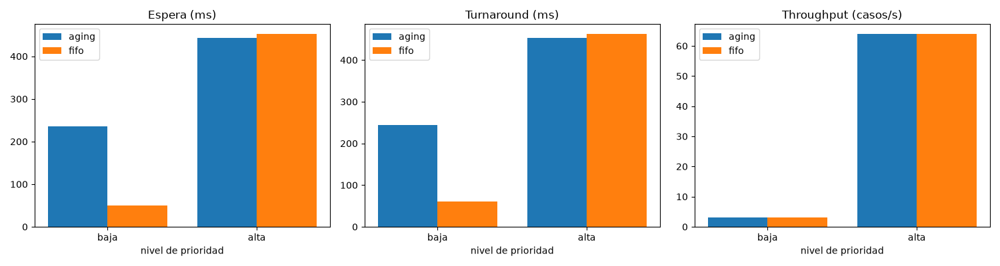

# M2 · Planificación

**Responsable:** Nahúm Murillo (`nahum0804`).

## Qué se implementó

F-20 agrega `Priority` (cuatro niveles), `SchedulingPolicy` (FIFO, aging) y `SchedulerState` en `src/domain/scheduling.py`: el aging es implícito, con `puntaje = t_entrada − bono(prioridad)` y el menor puntaje sale primero (AD-04). F-21 agrega `SchedulingPolicy.desde_configuracion(valor)` para elegir la política por configuración (variable `SCHED_POLICY`) y `scripts/measure/m2_sched.py`, que simula una carga sintética bajo cada política y mide espera, turnaround y throughput por nivel. F-34 mide, con `scenarios/worker_crash.py`, el tiempo real de detección y reasignación del reaper heredado ante la caída de un worker (ver `docs/evidencia/F-34_caida_worker_2026-11-12.md`): 20.0 s con el `reaper_interval` de producción, refinando la estimación informal de `docs/DEMO.md`. F-35 mide, con `scenarios/coordinator_restart.py`, si el coordinador retoma casos en curso sin perder ni duplicar sub-tareas tras un reinicio (ver `docs/evidencia/F-35_reinicio_coordinador_2026-11-12.md`): 0 pérdidas/duplicadas en 3 repeticiones, confirmando AD-21 (coordinador sin estado, nada que reconciliar fuera de Redis) con datos reales en vez de la cifra histórica sin medir de I Proyecto.

## Concepto de Sistemas Operativos

Ambas políticas son lógica de planificación pura (sin E/S de red ni disco): deciden, dado un conjunto de casos en cola con su prioridad y momento de llegada, cuál se despacha primero. FIFO ordena estrictamente por `entered_at`. Aging asigna a cada caso un puntaje fijo `entrada − bono`: un caso posterior solo puede adelantarlo si la diferencia de llegada es menor que la diferencia de bonos. Los 400 ms entre crítica y baja limitan esa ventana de adelantamiento, no la espera total; esta depende también del trabajo previamente encolado y de la capacidad de servicio.

Referencia bibliográfica existente: Silberschatz, Galvin y Gagne, *Operating System Concepts*, 10.ª ed., capítulo 5, planificación de CPU e inanición (R2 de ARQUITECTURA; edición del curso por confirmar, SUP-16).

## Método de medición

`scripts/measure/m2_sched.py` simula un servidor único: encola `--low` casos de prioridad baja al inicio (t=0, ya en espera, como describe el criterio de aceptación), luego una ráfaga de `--high-rate` casos de prioridad alta que llegan de forma continua (intervalo medio 5 ms, con ruido gaussiano fijado por `--seed`), despachando a la mitad de esa tasa durante la ráfaga (intervalo medio de servicio 10 ms) para generar un backlog creciente, y drena el resto al terminar la ráfaga. El reloj es virtual (se parchea `time.time` dentro del script, igual que en las pruebas unitarias de F-20) para que la medición sea determinista y rápida, sin reloj real ni red:

```bash
SCHED_POLICY=fifo python scripts/measure/m2_sched.py --high-rate 100 --low 5 --seed 42 --out m2_fifo_42.csv
SCHED_POLICY=aging python scripts/measure/m2_sched.py --high-rate 100 --low 5 --seed 42 --out m2_aging_42.csv
```

Se repitió con las semillas 42, 43 y 44 para ambas políticas. El CSV crudo combinado está en `docs/evidencia/F-21_comparacion_politicas_2026-11-11.csv`.

**Nota de alcance:** esta es una simulación en memoria de la lógica de `SchedulerState` (CPU y orden de decisión), no una medición del SO ni una corrida distribuida sobre los tres nodos reales del clúster. Comprueba el escenario simulado; no acredita el comportamiento del planificador desplegado. El CSV solo cubre baja y alta, no media y crítica.

## Resultados

Media de las 3 repeticiones (ms, salvo throughput en casos/s):

| Política | Nivel | Espera (ms) | Turnaround (ms) | Throughput (casos/s) |
|---|---|---|---|---|
| FIFO | baja | 50.6 | 60.7 | 3.20 |
| FIFO | alta | 452.8 | 462.9 | 64.0 |
| Aging | baja | 235.0 | 244.2 | 3.20 |
| Aging | alta | 443.6 | 453.7 | 64.0 |

Mayor **espera media por semilla** de prioridad baja bajo aging: **245.789 ms** (semilla 43). El CSV no contiene máximos individuales: no permite afirmar que ninguna espera superó 400 ms.

El throughput por nivel es igual entre políticas: con la misma semilla, ambas corridas despachan el mismo número total de casos en el mismo tiempo total (makespan); la política solo decide el *orden*, no la *cantidad* de trabajo hecho. La diferencia real está en la espera y el turnaround.



Generado con `python scripts/measure/m2_plot.py docs/evidencia/F-21_comparacion_politicas_2026-11-11.csv --out docs/evidencia/F-21_comparacion_politicas_2026-11-11.png`.

## Interpretación

En este escenario los cinco casos bajos ya estaban en cola al comenzar la ráfaga alta. FIFO los atiende antes que las llegadas posteriores: un caso que llega más tarde espera el trabajo anterior, pero los nuevos casos no lo adelantan. Con trabajo anterior finito y servicio que progresa, esta disciplina no produce inanición por prioridad.

Aging aumenta la espera media baja de 50.6 a 235.0 ms y reduce la alta de 452.8 a 443.6 ms, para esta simulación. Las diferencias describen el orden de servicio, no una mejora de capacidad. La ventana de adelantamiento de AD-04 no es una cota universal de espera.

Las tres simulaciones completan los casos bajos, pero sus medias agregadas no prueban un máximo individual ni ausencia general de inanición bajo cualquier carga. Faltan evidencia adecuada por los niveles exigidos y la comprobación del comportamiento desplegado para acreditar RNF-10 completo. Recálculo documental en [F-41](evidencia/F-41/recalculos.md); no es un experimento nuevo.
